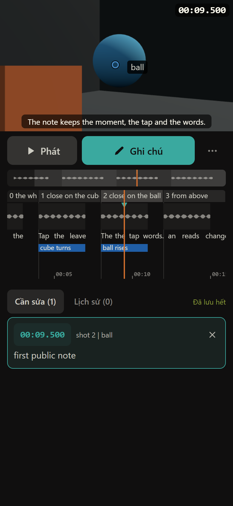

# Live Studio

A review room and timeline editor for Three.js films: the creator watches on a PC or phone and pins notes to a moment and a spot, an AI agent reads them and changes the film's code. The creator can also edit the timeline CapCut-style (sound clips, camera keys and eases, cuts, placed objects, fades); those edits go into the film's timeline files, and its code stays the agent's.



```bash
bun run demo -- 4321     # the demo film at http://localhost:4321; needs Node 22+, Bun, Python 3, ffmpeg
```

Local only and without a password: reach it from a phone through `tailscale serve` with the host name in the film's `.live_hosts` (any other name gets 403), never from the open internet.

## On your film

Every film in this monorepo shares this one studio (`"live-studio": "workspace:*"`); never copy it into a film.

```bash
bun run new-film <name>                 # at the monorepo root: copies templates/film, runs init.mjs, links the vault
cd films/<name> && bun run studio       # prints the creator's link (Tailscale) or what is missing
bun run notes [ID]                      # the creator's notes; bun run note done ID "..." when one is fixed
bun run render stills|clip              # draft stills or the draft video; options and checks in the header of render.mjs
bun run framecheck                      # faults in a rendered video
```

What a film must provide and every rule an agent follows: [docs/film-contract.md](docs/film-contract.md).

## Working on the studio

- `app/` is the React page (shadcn/ui on Base UI, Tailwind, Zustand) that Vite rebuilds with the film on every save (`src/page.mjs`). One folder per part of the page, each with its state (`slice.ts`), its logic and its panels: `picture/`, `playback/`, `notes/`, `timeline/`, `sound/`, `camera/`, `keys/`, `objects/`, `options/`. `core/` is what they share (the store, saved settings in `prefs.ts`, film time), `shell/` the frame around them (side bar, transport, settings, hotkeys), `start.ts` the start and the frame loop.
- `src/` is the server (restart each studio after changing it), `render/` the draft renderer and its checks, `checks/` the numbers those checks and framecheck compute (pure, tested in node).
- `bun run test` runs the tests, `bun run typecheck` the types.

## License

MIT; built on three.js, three-mesh-bvh, Vite, React, shadcn/ui, Base UI, Tailwind CSS, Hono, Zustand, TanStack Hotkeys, Zod, bezier-easing, bezier-easing-editor, vite-plugin-compression2 (all MIT), class-variance-authority (Apache-2.0), Lucide (ISC) and Mediabunny (MPL-2.0, unmodified).
